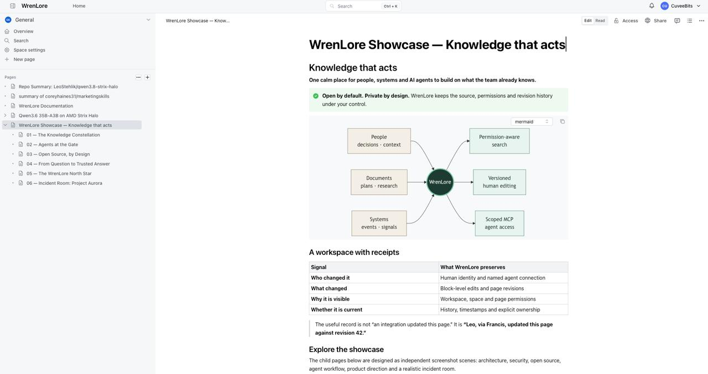
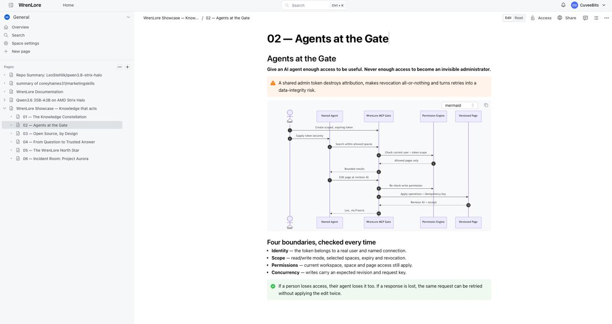
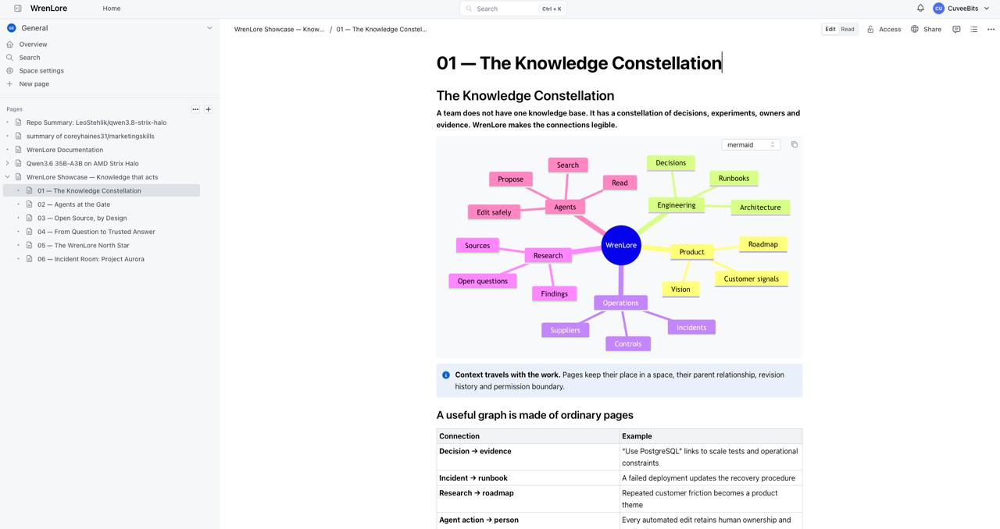
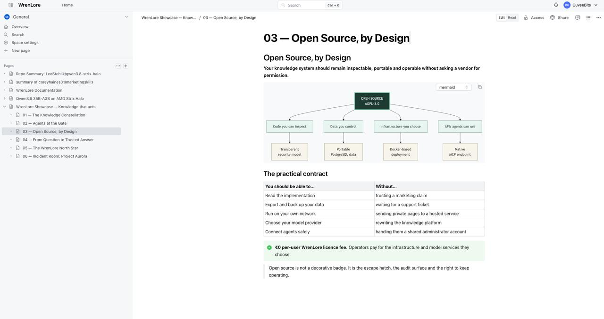
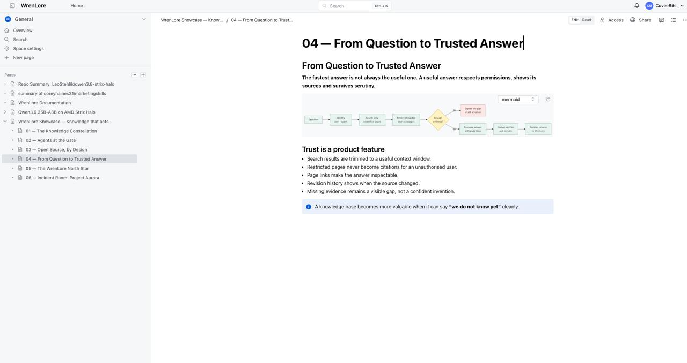
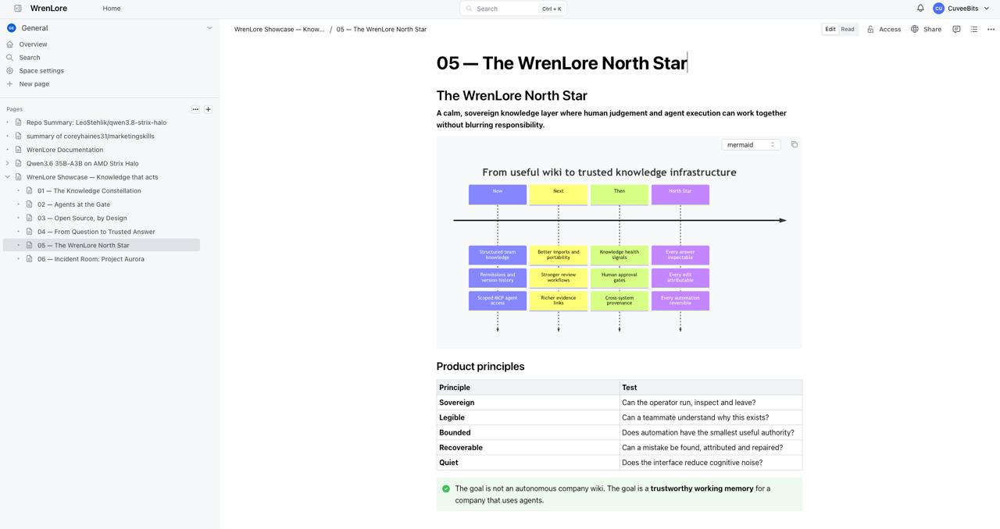
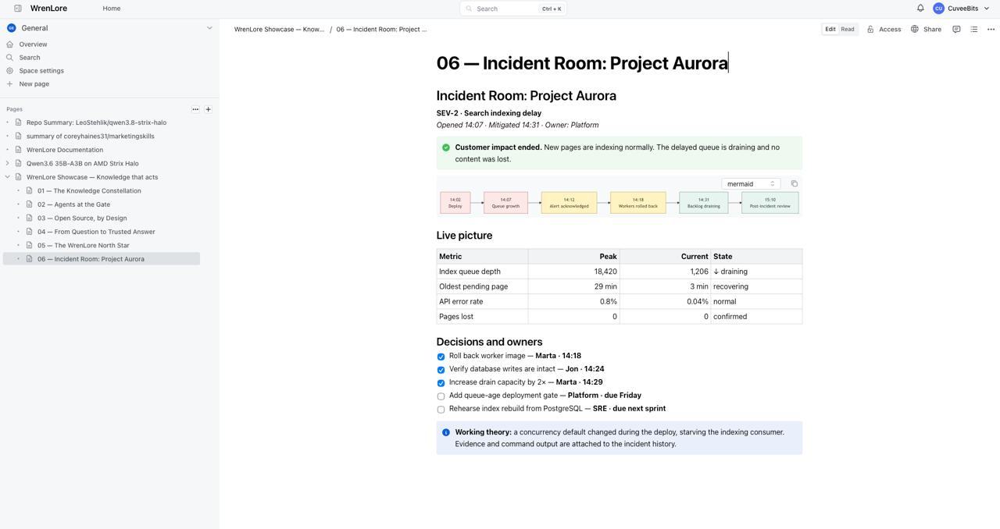

# WrenLore

[](https://github.com/wrenlore/wrenlore/actions/workflows/mcp-regressions.yml)
[](https://github.com/wrenlore/wrenlore/actions/workflows/editor-regressions.yml)
[](https://github.com/wrenlore/wrenlore/releases/latest)
[](LICENSE)

**Self-hosted knowledge infrastructure for humans and AI agents.**

WrenLore is a collaborative wiki for teams that want clean human editing, private deployment and useful AI access without giving an agent a shared administrator account.

[Website](https://wrenlore.com/) · [Releases](https://github.com/wrenlore/wrenlore/releases) · [Deployment guide](README-deploy.md) · [MCP setup](docs/MCP.md) · [Official MCP Registry](https://registry.modelcontextprotocol.io/v0.1/servers/io.github.wrenlore%2Fwrenlore/versions/latest) · [Security](SECURITY.md)



## What makes WrenLore different

| Capability | What it means in practice |
|---|---|
| **A proper team wiki** | Structured pages, spaces, comments, page permissions, public sharing and version history in a focused web interface. |
| **Scoped MCP access** | Agents search, read, create and revision-safely edit knowledge through user-owned tokens with read/write, space and expiry controls. |
| **Attribution that survives automation** | Supported agent actions are recorded as **User, via Agent**, rather than disappearing behind a generic integration account. |
| **Grounded AI workflows** | Permission-aware retrieval, provider/model administration and AI-assisted editing keep answers attached to the team's real source material. |
| **Identity and operational control** | SSO, local MFA, audit events and self-hosted deployment give operators control over access, infrastructure and data. |
| **Open source** | AGPL-3.0 source, PostgreSQL data and Docker-based deployment provide a real exit path instead of a decorative export button. |

WrenLore has no per-user licence fee. You run the infrastructure and choose any external model services you want to connect.

## Quick start

Install WrenLore with one command:

```bash
curl -fsSL https://raw.githubusercontent.com/wrenlore/wrenlore/master/install.sh | bash
```

The installer requires a running Docker Engine with the Docker Compose plugin, accessible to the current user. It does not install or configure Docker or elevate privileges.

It generates strong secrets, starts PostgreSQL/pgvector and Redis, and reports success only after WrenLore is healthy.

Open [http://localhost:3000](http://localhost:3000). Rerunning the installer preserves secrets and persistent data.

Prefer to delegate the checks and installation to a coding or operations agent? Use the [agent installation guide](docs/AGENT_INSTALL.md), including its paste-ready prompt and machine-checkable completion criteria.

For domains, TLS, reverse-proxy configuration, backups, source builds and production values, use the [deployment runbook](README-deploy.md). The exact Docker-only support boundary is recorded in the [deployment contract](docs/DEPLOYMENT_CONTRACT.md).

## Built for agent access without the shared admin token

WrenLore exposes a Streamable HTTP MCP endpoint at `/mcp`. A workspace administrator enables agent connections, then each user creates their own named token.

Tokens can be:

- read-only or read/write;
- restricted to selected spaces;
- given an expiry and revoked independently;
- copied once, then stored as a hash;
- traced back to the owning user and named agent connection.

The user's live workspace, space and page permissions remain authoritative on every call. Writes use expected revisions and idempotency keys, so an agent cannot silently overwrite a newer human edit or apply the same operation twice after a lost network response.

Current MCP tools cover context, spaces, page trees, search, page reads, page creation, direct document edits, comments and history. Deletion, moves, sharing and permission changes are deliberately outside MCP V1.

See [MCP setup, client examples and editing semantics](docs/MCP.md).

WrenLore is published as `io.github.wrenlore/wrenlore` in the [official MCP Registry](https://registry.modelcontextprotocol.io/v0.1/servers/io.github.wrenlore%2Fwrenlore/versions/latest). The registry record uses a self-hosted hostname variable and a secret Authorization header, so it describes operator-run deployments without pretending WrenLore is a hosted SaaS endpoint.



## A few real workspace views

<table>
  <tr>
    <td width="50%">
      
      <br /><strong>Connected knowledge</strong><br />Decisions, evidence, owners and operational context stay legible.
    </td>
    <td width="50%">
      
      <br /><strong>Open by design</strong><br />Inspect the code, control the data and choose where it runs.
    </td>
  </tr>
  <tr>
    <td width="50%">
      
      <br /><strong>Grounded answers</strong><br />Permission-aware retrieval keeps answers inspectable and bounded.
    </td>
    <td width="50%">
      
      <br /><strong>A practical direction</strong><br />Portable knowledge, human approval and attributable automation.
    </td>
  </tr>
</table>



The showcase pages above were created through WrenLore's own MCP endpoint and persisted with **User, via Agent** attribution.

## Deployment shape

The supplied Compose stack runs:

- the WrenLore application, built from this repository;
- PostgreSQL with pgvector;
- Redis with append-only persistence;
- local file storage by default, with S3-compatible storage available.

Docker is the preferred deployment and deployment-like verification path. WrenLore does not use upstream Docmost images, update flows or release automation.

## Documentation

- [Deployment runbook](README-deploy.md)
- [MCP setup and semantics](docs/MCP.md)
- [Page-history user guide](docs/user-guide/page-history.md)
- [Entra ID SAML setup](docs/SAML_ENTRA_SETUP.md)
- [Contributing](CONTRIBUTING.md)
- [Public release checklist](docs/PUBLIC_RELEASE_CHECKLIST.md)
- [Public provenance summary](docs/provenance/public-release-provenance.md)

## Provenance and licensing

WrenLore is derived from the Docmost Community Edition codebase. The WrenLore public foundation is tagged `wrenlore-open-foundation-2026-05-01` in this repository, and the codebases diverge from that point.

WrenLore is not an upstream Docmost deployment target and is not affiliated with or endorsed by Docmost. Docmost and related marks are trademarks of Docmost Inc.

WrenLore is derived from AGPL-3.0-licensed Docmost Community code and is itself licensed under AGPL-3.0. This repository does not include Docmost Enterprise Edition source code, assets, tests, documentation or implementation details. Public visibility of upstream Enterprise Edition material is not permission to reuse it.

WrenLore's SSO, audit, AI, sharing controls and other product capabilities are WrenLore-native implementations based on WrenLore requirements, public standards, public documentation, public interoperability behaviour and original implementation work. Feature overlap can exist between products; this project does not reuse proprietary Docmost Enterprise implementation.

Source for every released WrenLore version is available through the corresponding tag and release archive. See the [public provenance summary](docs/provenance/public-release-provenance.md) and [contribution policy](CONTRIBUTING.md) for the clean-cut engineering rules.

## Security posture

WrenLore tracks vulnerabilities in its dependency stack and inherited Community-derived code. After the documented fork point, fixes are implemented independently from public vulnerability disclosures and WrenLore code analysis; the project does not cherry-pick, merge or rebase from upstream Docmost.

Security reports are handled under [SECURITY.md](SECURITY.md). Audit coverage is actively expanded and is not represented as complete for every browser and administrative action.

## Licence

WrenLore is provided under the [GNU Affero General Public License v3.0](LICENSE), without warranty.
